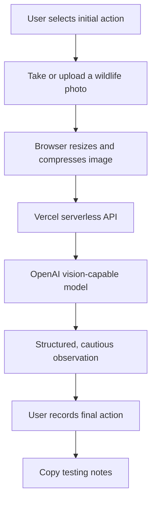

# Wildlife-Smart Camera — AI-assisted wildlife observation

**Live prototype:** [wildlifecam.vercel.app](https://wildlifecam.vercel.app)  
**Source code:** [wildlife-smart-camera/](wildlife-smart-camera/)

A mobile-friendly design-thinking prototype exploring a practical question: **Can contextual AI guidance help someone make a safer, more informed decision after spotting an unfamiliar animal?** This is an educational interface and user-testing experiment, *not* a validated species-identification system, veterinary tool, or wildlife-rescue service.

**Built with:** JavaScript · HTML/CSS · browser camera and file APIs · Vercel serverless functions · OpenAI Responses API · PWA manifest/service worker

## The user problem

People who encounter a bird, squirrel, or other animal outdoors may be uncertain about what they're looking at and whether to intervene. Reacting too quickly can be unsafe for wildlife and people. This prototype tests a lightweight, safety-first experience that encourages users to **observe from a distance** and consult wildlife professionals when needed.

## What I designed and built

- **Before/after decision capture:** Participants record what they would do before viewing AI-assisted guidance, then record what they would do afterward.
- **Photo inputs:** Use a device camera or upload an existing photo; the browser compresses the image to JPEG before submission.
- **Server-side AI integration:** A Vercel function sends the supplied image and safety-constrained prompt to the OpenAI Responses API using a server-side environment variable.
- **Structured observations:** The response is parsed into an identification candidate, cautious certainty level, visible clues, a short description, and safety guidance.
- **Safety-first experience:** The interface explicitly discourages approaching, moving, handling, or feeding wildlife and directs users to appropriate local professionals for suspected injuries or danger.
- **Lightweight web app:** Includes a web manifest and service worker for an installable-style browser experience. AI analysis still requires internet access.

## How the workflow works



**Important:** A photograph may be ambiguous. The AI output cannot reliably determine whether an animal is injured, abandoned, or needs help. Model identification can be incorrect.

## My design and testing approach

I built this for a human-centered design project and tested how people navigate the experience, interpret the AI output, and make decisions. Feedback surfaced issues such as an initially unclear decision dropdown and the desire for camera zoom to capture distant animals without approaching them. Those observations are useful product-design signals, **not evidence of a statistically validated change in behavior**.

The design principle is to prioritize safe observation, explain uncertainty, and keep people in control of their next action.

## Project layout

```text
wildlife-smart-camera/
  public/
    index.html             Interface and pre/post decision prompts
    app.js                 Camera/upload logic, compression, AI request and result display
    style.css              Responsive styling
    manifest.webmanifest   Installable web app metadata
    sw.js                  Basic offline shell behavior
  api/
    analyze.js             Serverless OpenAI API request and response handling
  vercel.json              Vercel configuration
  README.md                Developer setup and safety notes
```

## Run locally or deploy

The application source is under [`wildlife-smart-camera/`](wildlife-smart-camera/). See its [developer README](wildlife-smart-camera/README.md) for step-by-step Vercel deployment.

**Prerequisites:** A Vercel environment (or Vercel CLI for local serverless development) and an OpenAI API key with access to a vision-capable model.

1. Deploy the nested `wildlife-smart-camera` folder as the Vercel project root.
2. Configure `OPENAI_API_KEY` as a **server-side environment variable** in Vercel. Optionally configure `OPENAI_MODEL` to use another supported vision-capable model.
3. Deploy over HTTPS, grant browser camera permission if using the camera, or select a photo from your device.
4. Use the initial-action selector, submit an image, review the guidance, and record the final action.

**Never commit API keys to GitHub or place them in browser JavaScript.** Model calls may incur usage charges. The public prototype should have rate limits, usage budgets, privacy disclosure, and other abuse controls before broader deployment.

## Limitations and next steps

- Identification and safety information may be mistaken or incomplete.
- The prototype does not diagnose animal injuries or provide wildlife rescue decisions.
- Camera zoom is not implemented; users should **not approach wildlife** to get a closer photo.
- The before/after experience supports qualitative usability testing, not proof that the model changes behavior.
- Improving UI clarity, camera controls, privacy, accessibility, and systematic evaluation would make the experience stronger.

## What this demonstrates

I enjoy combining **hands-on AI development, user research, product design, and technical storytelling**. This project required turning a real-world decision into a testable experience; implementing browser, API, and model workflows; troubleshooting integration issues; and explaining the limitations of AI responsibly.

**More of my work:** [Portfolio](https://brendayahm.com) · [LinkedIn](https://www.linkedin.com/in/brenda-yahm)
